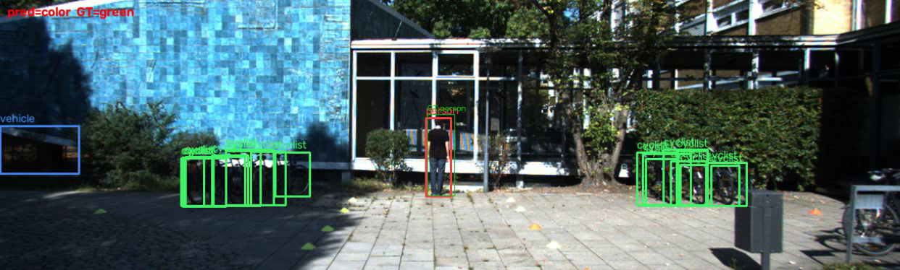
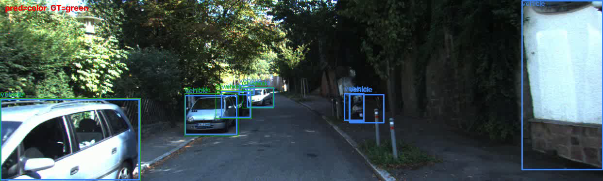
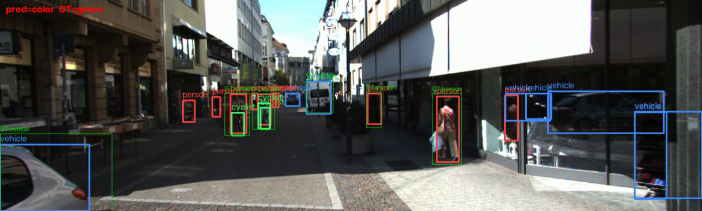

# Zero-Shot 2D Object Detection Across COCO and KITTI

**Track A - Experimental Evaluation**

**Rohan Ohlan** | CMPE 249 | Dr. Kai Kai Liu  
November 2, 2026

[Experiment code and archived results](https://github.com/rohan328/CMPE249Assignment1/tree/3782492ec58c86520db2eeaecc100964730bfdbc/results) | [Higher-threshold results](https://github.com/rohan328/CMPE249Assignment1/tree/3782492ec58c86520db2eeaecc100964730bfdbc/results_025)

## Abstract

Four COCO-pretrained detectors are evaluated on 5,000 COCO validation images and 5,984 labeled KITTI training-partition images, without fine-tuning. A shared vehicle/person/cyclist taxonomy enables comparison but introduces important annotation differences. At confidence 0.05, RT-DETR-R50 has the highest custom three-class AP on COCO (51.71) and KITTI (24.32). YOLO11m has the lowest measured FP32 prediction latency on an RTX 3060 Ti: 25.26 ms, or 39.59 FPS, with KITTI AP of 23.12. The cross-dataset AP decreases range from 19.76 to 28.28 percentage points. Raising the outer confidence cutoff to 0.25 reduces AP and AR100 in all eight comparisons. Inspection of archived videos reveals spurious vehicle boxes and bicycle-to-cyclist mapping errors. These results evaluate complete inference configurations; they are not official COCO or KITTI leaderboard scores.

## 1. Research questions and detector selection

The study asks: how much accuracy transfers from COCO [5] to KITTI [6], which classes and scales degrade most, and what accuracy is obtained at each measured latency? The selected configurations span two-stage proposal detection, dense one-stage detection, and query-based set prediction. No detector is trained or fine-tuned on KITTI.

| Configuration | Architecture and purpose |
| --- | --- |
| Faster R-CNN ResNet-50-FPN v2 | Two-stage, anchor-based RPN and RoI head; proposal baseline [1, 7, 8]. |
| RetinaNet ResNet-50-FPN v2 | One-stage, anchor-based dense prediction; focal-loss baseline [2, 7, 8]. |
| YOLO11m | One-stage, anchor-free dense prediction and multiscale fusion; practical speed comparison [9]. |
| RT-DETR R50-vd | ResNet-D backbone, hybrid encoder and transformer decoder; NMS-free query-based comparison [3, 4, 10]. |

Faster R-CNN shares features between proposals and region classification. RetinaNet uses focal loss to address dense foreground/background imbalance. DETR introduced bipartite set prediction; RT-DETR improves efficiency with a hybrid encoder and query selection. These mechanisms motivate comparison, but the measurements do not isolate architecture as the sole cause of performance differences.

## 2. Data, execution evidence and environment

| Dataset | Evaluated split | Images / mapped GT boxes |
| --- | --- | --- |
| COCO 2017 | val2017; instances_val2017.json | 5,000 / 14,513 |
| KITTI object detection | Labeled training partition; ImageSets/train.txt | 5,984 / 31,825 |

Each image count is confirmed in every model entry of the two metrics files. The per-image JSONs also agree on mapped GT counts and evaluation-index order across all four models and both thresholds. Their image_id fields are contiguous evaluation indices, not original KITTI filenames or COCO IDs [11].

### 2.1 Recovering the KITTI split

The loader defaults to split="train" and reads ImageSets/train.txt. When creating a split, KittiDataset._create_imagesets_splits() sorts the image stems, shuffles with Python seed 42, and takes int(0.8N) training entries. Reconstructing this procedure over 000000 through 007480 gives 5,984 IDs. Encoding the list with Windows CRLF line endings and no final newline exactly reproduces the archived split hash:

`A74F0E28EB0F0245BFB256ECDE002CD9A2CCFDC07ECDC0E138349D80E0E1F134`

The first entries are 001736, 005203 and 002375. This reconstruction recovers the list identified by the archived digest; it does not establish that the original runtime file was immutable throughout both sweeps. The dataset itself is not redistributed. Evaluation on this labeled training partition is a zero-shot test because no KITTI fitting is reported; future adaptation must use a disjoint holdout.

### 2.2 Hardware and software

| Item | Recorded evidence |
| --- | --- |
| GPU / capacity | NVIDIA GeForce RTX 3060 Ti; 8,192 MiB capacity. Per-model peak allocation was not measured. |
| GPU software | gpu.txt: NVIDIA driver/KMD 616.56; CUDA UMD 13.4; WDDM. This is not a CUDA toolkit-version measurement. |
| Host | Author-reported Ryzen 7 5700G, Windows 11, Python 3.12.16; RAM not recorded. |
| Archived packages | torch 2.15.0+cu132; torchvision 0.29.2+cu132; transformers 5.22.1; ultralytics 8.4.198; pycocotools 2.0.11. |
| Run mode | Native FP32, one image per predict() call. Latency JSON independently records fp32 for all models. |

The package versions above are transcribed from requirements-lock.txt, rather than inferred from current releases. Model specifications and checkpoints appear in Section 9. Resolved checkpoint hashes/cache revisions were not archived.

## 3. Taxonomy and evaluation protocol

| Unified class | COCO categories | KITTI categories |
| --- | --- | --- |
| Vehicle | car, truck, bus, train, motorcycle | Car, Van, Truck, Tram |
| Person | person | Pedestrian, Person_sitting |
| Cyclist | bicycle | Cyclist |
| Excluded | Other categories | Misc, DontCare |

Taxonomy.build_id_lut() maps native names to the driving3 classes [11]. This avoids assuming that torchvision/Hugging Face and Ultralytics use identical COCO indices. Folding car and truck into vehicle removes within-group class errors. Native-class suppression precedes folding, so detections from merged categories can remain as duplicates.

**Cyclist is an imperfect correspondence.** A COCO bicycle prediction can differ in extent from a KITTI rider-and-bicycle box. A parked bicycle is also mapped to cyclist even when KITTI has no corresponding cyclist annotation. A rider predicted as person cannot match a cyclist ground-truth label. The measured gap therefore mixes visual transfer with class semantics and box geometry.

### 3.1 Metrics and annotation handling

AP averages precision over IoU thresholds 0.50:0.05:0.95 and 101 recall levels; AP50 and AP75 use fixed IoUs. Area groups use COCO boundaries at 32² and 96² pixels. AR1/10/100 cap detections per image and category [13]. All reported AP/AR values are on a 0-100 scale; differences are percentage points (pp).

COCOUnifiedEvaluator.add() rebuilds mapped annotations with box area and iscrowd=0. The protocol does not preserve native COCO segmentation areas/crowd treatment or KITTI DontCare/difficulty rules. Thus these are custom three-class COCO-engine metrics, not official 80-class COCO AP or KITTI easy/moderate/hard AP.

### 3.2 Preprocessing, native filtering and output

| Model | Geometry / native filtering | Unified output |
| --- | --- | --- |
| Faster R-CNN v2 | Aspect-preserving 800/1333 short/long-edge limits; ImageNet normalization. RoI score floor 0.05, NMS IoU 0.5; 100 final detections. | Original-image xyxy; then shared score cutoff and label folding. |
| RetinaNet v2 | Same resize/normalization; score floor 0.05, NMS IoU 0.5; top 1,000 per level, 300 final detections. | Same unified step. |
| YOLO11m | 640 target, stride-aligned letterbox; pixel rescaling. Adapter passes conf=0.0; native class-aware NMS (default IoU 0.7), max_det=300. | Boxes restored to original size; then shared cutoff and folding. |
| RT-DETR-R50 | 640 x 640 resize; rescale 1/255, no mean/std normalization. Processor threshold=0.0; 300 queries; no conventional NMS. | target_sizes restores original-image xyxy; then cutoff and folding. |

Geometry, native thresholds and caps not explicitly overridden by ngdet are framework/checkpoint defaults [8-10, 12]. The common outer cutoffs (0.05/0.25) do not imply identical internal filtering, calibration or input tensors. The adapter calls were inspected in detectors/torchvision_det.py, yolo.py, hf_detr.py and base.py [11].

## 4. Accuracy results at confidence 0.05

### 4.1 Overall AP and transfer gap

| Model | COCO AP | KITTI AP | Gap (pp) | AP retained (%) |
| --- | --- | --- | --- | --- |
| Faster R-CNN v2 | 49.15 | 23.61 | 25.54 | 48.04 |
| RetinaNet v2 | 43.48 | 23.72 | 19.76 | 54.55 |
| YOLO11m | 51.40 | 23.12 | 28.28 | 44.97 |
| RT-DETR-R50 | 51.71 | 24.32 | 27.38 | 47.04 |

RT-DETR ranks first in both domains. The spread across models falls from 8.22 pp on COCO to 1.21 pp on KITTI. Retention is 100 x KITTI AP / COCO AP; a smaller gap alone does not establish a better target-domain detector.

### 4.2 IoU thresholds and object scale

| Model | Data | AP | AP50 | AP75 | AP S | AP M | AP L |
| --- | --- | --- | --- | --- | --- | --- | --- |
| Faster R-CNN v2 | COCO | 49.15 | 75.21 | 52.27 | 28.60 | 49.94 | 65.96 |
| Faster R-CNN v2 | KITTI | 23.61 | 43.73 | 23.44 | 11.98 | 23.12 | 31.22 |
| RetinaNet v2 | COCO | 43.48 | 69.02 | 44.78 | 21.78 | 45.15 | 61.00 |
| RetinaNet v2 | KITTI | 23.72 | 44.85 | 22.72 | 12.95 | 22.85 | 31.57 |
| YOLO11m | COCO | 51.40 | 72.15 | 55.20 | 24.79 | 53.50 | 72.51 |
| YOLO11m | KITTI | 23.12 | 43.14 | 22.77 | 11.48 | 22.05 | 30.59 |
| RT-DETR-R50 | COCO | 51.71 | 75.42 | 54.15 | 26.62 | 52.66 | 72.60 |
| RT-DETR-R50 | KITTI | 24.32 | 44.91 | 23.68 | 13.14 | 23.40 | 32.28 |

### 4.3 Recall under detection caps

| Model | Data | AR1 | AR10 | AR100 | AR S | AR M | AR L |
| --- | --- | --- | --- | --- | --- | --- | --- |
| Faster R-CNN v2 | COCO | 23.16 | 55.28 | 60.57 | 43.80 | 62.86 | 74.47 |
| Faster R-CNN v2 | KITTI | 10.96 | 31.62 | 34.13 | 31.84 | 33.44 | 37.84 |
| RetinaNet v2 | COCO | 21.93 | 50.16 | 57.81 | 38.59 | 61.56 | 72.09 |
| RetinaNet v2 | KITTI | 11.56 | 33.19 | 37.95 | 31.57 | 38.38 | 42.85 |
| YOLO11m | COCO | 23.61 | 56.04 | 60.26 | 36.23 | 64.61 | 78.84 |
| YOLO11m | KITTI | 10.62 | 29.97 | 31.41 | 24.71 | 31.37 | 37.05 |
| RT-DETR-R50 | COCO | 23.59 | 57.57 | 66.67 | 48.26 | 68.48 | 82.86 |
| RT-DETR-R50 | KITTI | 10.81 | 31.48 | 35.33 | 30.83 | 34.96 | 39.71 |

Source: results/full/metrics.json, all eight completed model-dataset entries. Values are regenerated from unrounded JSON. S/M/L denote small/medium/large. Full machine-readable results and generated reports remain in the linked archive [11].

## 5. Analysis I: cross-dataset generalization

### 5.1 Per-class performance

| Model | Data | Vehicle AP | Person AP | Cyclist AP |
| --- | --- | --- | --- | --- |
| Faster R-CNN v2 | COCO | 53.13 | 56.47 | 37.85 |
| Faster R-CNN v2 | KITTI | 45.12 | 25.60 | 0.12 |
| RetinaNet v2 | COCO | 47.80 | 51.07 | 31.58 |
| RetinaNet v2 | KITTI | 46.41 | 24.56 | 0.20 |
| YOLO11m | COCO | 55.29 | 59.01 | 39.88 |
| YOLO11m | KITTI | 45.65 | 23.61 | 0.09 |
| RT-DETR-R50 | COCO | 56.28 | 59.32 | 39.52 |
| RT-DETR-R50 | KITTI | 48.97 | 23.85 | 0.16 |

Vehicles transfer better than people in this protocol. Vehicle AP decreases by 8.02, 1.39, 9.64 and 7.32 pp for Faster R-CNN, RetinaNet, YOLO11m and RT-DETR, respectively. Person AP decreases by 30.87, 26.52, 35.41 and 35.47 pp. Cyclist AP falls from 31.58-39.88 on COCO to 0.09-0.20 on KITTI, but the mapping prevents attributing that collapse solely to recognition failure.

RetinaNet has the smallest overall gap (19.76 pp) and highest retention (54.55%), while starting from the lowest COCO AP. RT-DETR instead has the highest KITTI vehicle AP (48.97); Faster R-CNN has the highest KITTI person AP (25.60). Detector choice therefore depends on the target class as well as the overall mean.

As a diagnostic, the mean of existing KITTI vehicle/person AP values is 35.36, 35.48, 34.63 and 36.41 for the four models in the same order. This arithmetic summary leaves the original prediction pipeline unchanged; it is not a rerun with a corrected taxonomy. It shows the influence of the near-zero cyclist term without resolving annotation mismatch.

### 5.2 Object scale and localization

Small-object AP is below large-object AP for every model in both datasets. RT-DETR has the highest KITTI small-object AP (13.14), while Faster R-CNN leads small-object AP on COCO (28.60). The ranking changes with both domain and scale.

The absolute small-object AP decreases range from 8.83 to 16.62 pp; large-object decreases range from 29.43 to 41.92 pp. Small objects are difficult within KITTI, but they do not have the largest absolute cross-dataset decline. Different class composition and annotation extents within area bins limit a scale-only interpretation.

KITTI AP50 is much higher than AP75 for every model. This is consistent with stricter overlap exposing errors, but AP also depends on misses, class labels and score ranking. The difference cannot isolate localization. RT-DETR leads KITTI AP75 (23.68), whereas RetinaNet leads AR100 (37.95). No bootstrap intervals or repeat-run uncertainty estimates were recorded, so small differences are descriptive.

## 6. Analysis II: speed-accuracy tradeoff

| Model | Mean ms | p50 ms | p90 ms | Std ms | FPS | KITTI AP |
| --- | --- | --- | --- | --- | --- | --- |
| Faster R-CNN v2 | 67.42 | 67.17 | 70.90 | 2.28 | 14.83 | 23.61 |
| RetinaNet v2 | 48.12 | 47.96 | 51.26 | 2.51 | 20.78 | 23.72 |
| YOLO11m | 25.26 | 24.91 | 25.90 | 1.72 | 39.59 | 23.12 |
| RT-DETR-R50 | 63.49 | 62.53 | 69.02 | 5.20 | 15.75 | 24.32 |

### 6.1 What was timed

The archived latency JSON records native FP32 inference on an NVIDIA GeForce RTX 3060 Ti. The reported command uses KITTI image training/image_2/000000.png (author-reported dimensions 1224 x 370), 10 warmup passes and 100 timed passes per model. This is a single-image benchmark, not a dataset-wide latency distribution.

latency.time_predict() calls predict(), synchronizes CUDA after warmup and after each timed call, and measures wall-clock milliseconds. Image decoding and model loading are outside the loop. Preprocessing, model execution, CPU output conversion and post-processing are inside it. FPS is 1000 / mean_ms, not an independent batched-throughput measurement [11].

benchmark() constructs detectors with score_thr=0.30, independently of the accuracy cutoffs 0.05 and 0.25. The table therefore pairs each model's accuracy with timing under a different outer score filter. Native candidate generation and suppression also differ among models. Neither equal input tensors nor architecture-only computational effects are established.

### 6.2 Accuracy obtained for the measured cost

YOLO11m is approximately 2.51 times as fast as RT-DETR and 2.67 times as fast as Faster R-CNN in this setup. Its KITTI AP is 1.21 pp below RT-DETR. YOLO11m is the fastest measured choice; RT-DETR has the highest observed target-domain AP. RetinaNet occupies an intermediate point: 48.12 ms and 23.72 KITTI AP.

For the two objectives of lower mean latency and higher three-class KITTI AP, YOLO11m, RetinaNet and RT-DETR are nondominated. Faster R-CNN is dominated by RetinaNet and RT-DETR on these two measures, but retains the highest person AP. A pedestrian-focused selection could consequently differ.

### 6.3 Architectural interpretation and limits

Faster R-CNN adds proposal generation and region-level processing to the shared feature extractor. RetinaNet and YOLO use dense multiscale heads. RT-DETR applies a hybrid encoder and query decoder. These differences affect computational profiles, but backbone capacity, resize geometry, framework overhead and post-processing vary too [1-4, 8-10].

NMS-free inference does not make RT-DETR the fastest detector here. Its encoder/decoder and framework costs remain. Published real-time throughput on a different accelerator or optimized backend is not directly comparable. No FP16, TensorRT, ONNX or compilation speedup is claimed. Peak per-model memory was not measured; the 8 GB GPU capacity is not an inference-memory result.

## 7. Confidence-threshold sensitivity

The second archived sweep has the same model identifiers, 5,000/5,984 image counts, evaluation-index order and mapped GT-count sequences. Each _meta.score_thr is 0.25. These checks support comparability, although they do not prove identical checkpoint bytes or image contents across runs. Deltas below use unrounded JSON values.

| Model | Data | AP .05 | AP .25 | Delta AP | AR100 .05 | AR100 .25 |
| --- | --- | --- | --- | --- | --- | --- |
| Faster R-CNN v2 | COCO | 49.15 | 48.36 | -0.79 | 60.57 | 57.69 |
| Faster R-CNN v2 | KITTI | 23.61 | 23.46 | -0.15 | 34.13 | 32.91 |
| RetinaNet v2 | COCO | 43.48 | 42.21 | -1.27 | 57.81 | 51.08 |
| RetinaNet v2 | KITTI | 23.72 | 23.42 | -0.30 | 37.95 | 32.87 |
| YOLO11m | COCO | 51.40 | 46.93 | -4.47 | 60.26 | 51.92 |
| YOLO11m | KITTI | 23.12 | 22.46 | -0.65 | 31.41 | 29.41 |
| RT-DETR-R50 | COCO | 51.71 | 50.15 | -1.56 | 66.67 | 58.75 |
| RT-DETR-R50 | KITTI | 24.32 | 23.98 | -0.35 | 35.33 | 31.38 |

AP and AR100 decrease in all eight comparisons. YOLO11m has the largest AP loss on COCO (-4.47 pp) and KITTI (-0.65 pp). RT-DETR remains first on both datasets. At 0.25, Faster R-CNN moves ahead of YOLO11m on COCO and RetinaNet on KITTI. Its KITTI advantage over RetinaNet is only 0.04 pp; statistical significance is not established.

### 7.1 Retained prediction counts on KITTI

| Model | Predictions at .05 | Predictions at .25 | Count reduction |
| --- | --- | --- | --- |
| Faster R-CNN v2 | 174,135 | 92,003 | 47.2% |
| RetinaNet v2 | 659,824 | 101,892 | 84.6% |
| YOLO11m | 83,102 | 42,243 | 49.2% |
| RT-DETR-R50 | 724,304 | 80,863 | 88.8% |

These totals are newly aggregated from the archived per-image num_pred fields, after native inference and unified filtering. They count retained detections, not true/false positives, and COCO evaluation may apply its own maxDets cap. Ground truth totals 31,825 mapped boxes in each KITTI file. More retained boxes do not by themselves imply more errors or better recall.

A higher cutoff removes low-score candidates and can restrict achievable recall. It might improve precision at a chosen operating point, but AP/AR and raw counts do not measure that precision. The lower cutoff is preferable for this study's AP reporting; it is not an established deployment threshold. Equal score cutoffs also do not equalize calibration across detector families.

Source: results/full/metrics.json, results_025/full/metrics.json and the corresponding pred_*__kitti.json files [11]. Complete 0.25 AP/AR and per-class tables are retained in the linked archive rather than duplicated in this PDF.

## 8. Failure analysis from inspected videos

Actual frames from the archived YOLO11m KITTI video at confidence 0.05 [11]; native filenames follow the hash-matched split. GT boxes are thin dark green with GT: labels. Predictions are blue (vehicle), red (person), bright green (cyclist). These diagnostic examples do not estimate error frequencies; scores and exact IoUs are unavailable.



**A. KITTI 006873, evaluation index 12 (2.4 s at 5 FPS).** Parked bicycles receive bright-green cyclist predictions, while the only mapped GT is the central person. The count file records 20 predictions and 1 GT. Mapping bicycle to cyclist creates semantic false positives here; this case is not evidence of rider-box mismatch.



**B. KITTI 001736, evaluation index 0 (0.0 s).** A large blue vehicle prediction encloses the roadside advertising panel at the far right, without a matching mapped GT vehicle there. Several actual cars are also detected. The visible unmatched box illustrates a background false-positive candidate at the low cutoff; its score is unavailable.



**C. KITTI 007410, evaluation index 4 (0.8 s).** In the left-middle group, red person predictions overlap regions labelled GT:cyclist, whereas the large person at the right is detected as person. A rider labelled person cannot satisfy cyclist-class matching. These visible class/extent differences are illustrative; exact IoUs cannot be recovered from the video.

## 9. Reproducibility and source provenance

results/repository-commit.txt records source commit `2e7426314e05b4f960c8befc531ee759625e9b1a`. The relevant ngdet files and KITTI/video helpers are unchanged between that commit and archive snapshot `3782492ec58c86520db2eeaecc100964730bfdbc`. The captured kitti-val-change.patch is empty. At the recorded source revision, DEFAULT_ROOTS already specifies datasets/Kitti/ and datasets/coco2017/val2017; no unrecorded path patch is needed to explain these roots.

The commands below reconstruct the settings reported with the experiments and make the archived default roots explicit. They are Bash commands from the repository root; no tracked command.log files were found in the archive. Treat this as a reproduction configuration, not a claimed original terminal transcript.

```bash
models=(torchvision:fasterrcnn_resnet50_fpn_v2
        torchvision:retinanet_resnet50_fpn_v2
        yolo:yolo11m.pt hf_detr:PekingU/rtdetr_r50vd)
for thr in 0.05 0.25; do
  out=results/full
  [ "$thr" = 0.25 ] && out=results_025/full
  python -m DeepDataMiningLearning.ngdet.run_eval \
    --models "${models[@]}" --datasets coco kitti \
    --taxonomy driving3 --max-images 0 --score-thr "$thr" \
    --device cuda --video --video-max 20 \
    --roots coco=datasets/coco2017/val2017 kitti=datasets/Kitti/ \
    --coco-ann datasets/coco2017/annotations/instances_val2017.json \
    --out-dir "$out"
done
python -m DeepDataMiningLearning.ngdet.latency \
  --models "${models[@]}" --accel fp32 --device cuda \
  --image datasets/Kitti/training/image_2/000000.png \
  --taxonomy driving3 --warmup 10 --iters 100 \
  --out-dir results/latency
```

Torchvision loads get_model_weights(model_name).DEFAULT; YOLO loads yolo11m.pt; Hugging Face loads PekingU/rtdetr_r50vd through AutoModelForObjectDetection and AutoImageProcessor. Keep the archived package lockfile. Resolved checkpoint revisions/hashes are unavailable. Video-max 20 caps only rendered frames, not evaluated images.

### 9.1 Hash-verified split reconstruction (Python)

```python
from pathlib import Path
import hashlib, random
ids = [f"{i:06d}" for i in range(7481)]
random.Random(42).shuffle(ids)
payload = "\r\n".join(ids[:int(0.8 * len(ids))]).encode()
expected = ("a74f0e28eb0f0245bfb256ecde002cd9a2"
            "ccfdc07ecdc0e138349d80e0e1f134")
assert hashlib.sha256(payload).hexdigest() == expected
Path("reconstructed-kitti-train.txt").write_bytes(payload)
```

Both accuracy sweeps contain 16 completed model-dataset-threshold entries and 8,028.3 seconds of evaluator wall time (4,008.8 at 0.05; 4,019.5 at 0.25). Timing includes model setup, dataset I/O, videos and metric computation. It is execution evidence rather than the controlled latency measurement. The archive also contains per-image counts, generated videos, a package lockfile and a GPU capture.

Source inspection: ngdet/run_eval.py:evaluate_one/main; datasets.py:EvalDataset; evaluator.py:COCOUnifiedEvaluator; taxonomy.py:Taxonomy; detectors/base.py:_fold_to_unified; latency.py:time_predict/benchmark; detection/dataset_kitti.py:KittiDataset [11].

## 10. Conclusions, limitations and references

RT-DETR-R50 achieves the highest observed custom AP on both datasets, while YOLO11m is fastest in the recorded FP32 timing setup. Vehicle transfer is stronger than person transfer. The cyclist collapse reflects substantial protocol incompatibility as well as possible domain difficulty; inspected parked-bicycle and rider examples show why recognition and taxonomy errors must be separated. A higher confidence cutoff reduces AP/AR and changes intermediate rankings.

The study compares complete pretrained configurations, not equal-input architecture ablations. Native filtering, input geometry and calibration differ. Crowd/ignore/area semantics are simplified; checkpoint hashes are unavailable; source provenance records a commit rather than a terminal transcript. The reconstructed split matches the archived digest, but no contemporaneous native-ID runtime manifest was stored. Latency covers one image, and uncertainty/peak inference memory were not measured. A useful next experiment is an annotation-compatible taxonomy plus disjoint KITTI adaptation/holdout evaluation.

## References

[1] S. Ren et al. Faster R-CNN: Towards Real-Time Object Detection with Region Proposal Networks. NeurIPS, 2015. [Source](https://arxiv.org/abs/1506.01497).

[2] T.-Y. Lin et al. Focal Loss for Dense Object Detection. ICCV, 2017. [Source](https://arxiv.org/abs/1708.02002).

[3] N. Carion et al. End-to-End Object Detection with Transformers. ECCV, 2020. [Source](https://arxiv.org/abs/2005.12872).

[4] Y. Zhao et al. DETRs Beat YOLOs on Real-time Object Detection. CVPR, 2024. [Source](https://arxiv.org/abs/2304.08069).

[5] T.-Y. Lin et al. Microsoft COCO: Common Objects in Context. ECCV, 2014. [Source](https://arxiv.org/abs/1405.0312).

[6] A. Geiger, P. Lenz and R. Urtasun. Are We Ready for Autonomous Driving? The KITTI Vision Benchmark Suite. CVPR, 2012. [Source](https://www.cvlibs.net/datasets/kitti/eval_object.php?obj_benchmark=2d).

[7] T.-Y. Lin et al. Feature Pyramid Networks for Object Detection. CVPR, 2017. [Source](https://arxiv.org/abs/1612.03144).

[8] PyTorch maintainers. Torchvision detection implementation and model documentation. [Source](https://github.com/pytorch/vision/tree/main/torchvision/models/detection).

[9] Ultralytics. YOLO11 documentation and official implementation. [Source](https://docs.ultralytics.com/models/yolo11/). [Repository](https://github.com/ultralytics/ultralytics).

[10] RT-DETR authors / Hugging Face. Official implementation and evaluated checkpoint configuration. [Source](https://github.com/lyuwenyu/RT-DETR). [Preprocessor](https://huggingface.co/PekingU/rtdetr_r50vd/blob/main/preprocessor_config.json); [Framework docs](https://huggingface.co/docs/transformers/model_doc/rt_detr).

[11] Kaikai Liu. DeepDataMiningLearning/ngdet tutorial; R. Ohlan experiment code, source and results archive. [Source](https://github.com/lkk688/DeepDataMiningLearning/blob/main/DeepDataMiningLearning/ngdet/TUTORIAL.md). [Recorded source](https://github.com/rohan328/CMPE249Assignment1/tree/2e7426314e05b4f960c8befc531ee759625e9b1a); [Results](https://github.com/rohan328/CMPE249Assignment1/tree/3782492ec58c86520db2eeaecc100964730bfdbc/results); [0.25 sweep](https://github.com/rohan328/CMPE249Assignment1/tree/3782492ec58c86520db2eeaecc100964730bfdbc/results_025).

[12] Ultralytics. Prediction settings, preprocessing and inference defaults. [Source](https://docs.ultralytics.com/modes/predict/).

[13] COCO maintainers. COCOeval reference implementation and detection metrics. [Source](https://github.com/cocodataset/cocoapi/blob/master/PythonAPI/pycocotools/cocoeval.py).

## AI assistance disclosure

ChatGPT/Codex assisted with analysis and report preparation, including reading the repository, checking JSON-derived values, reproducing the split digest and inspecting archived frames. These checks do not constitute new detector inference. Measured results remain those in the archived experiment artifacts.
